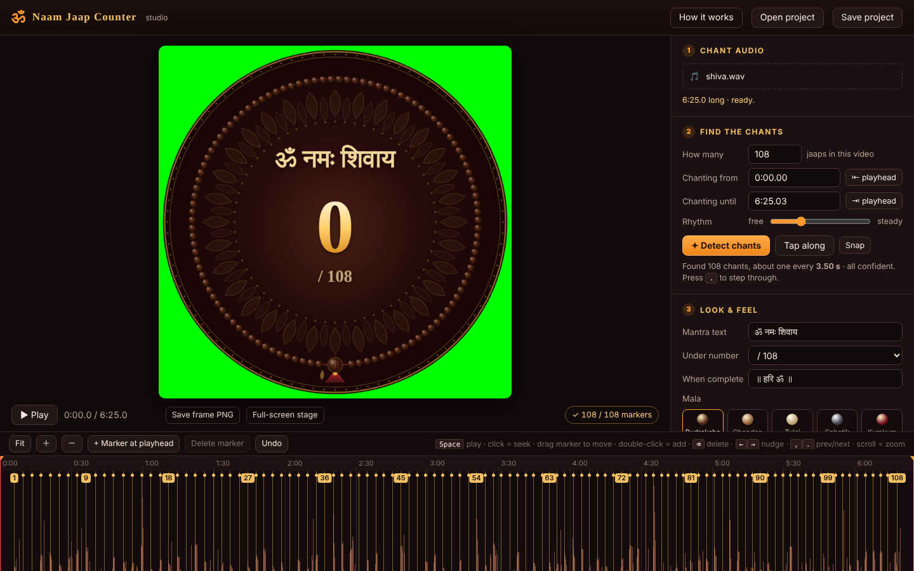
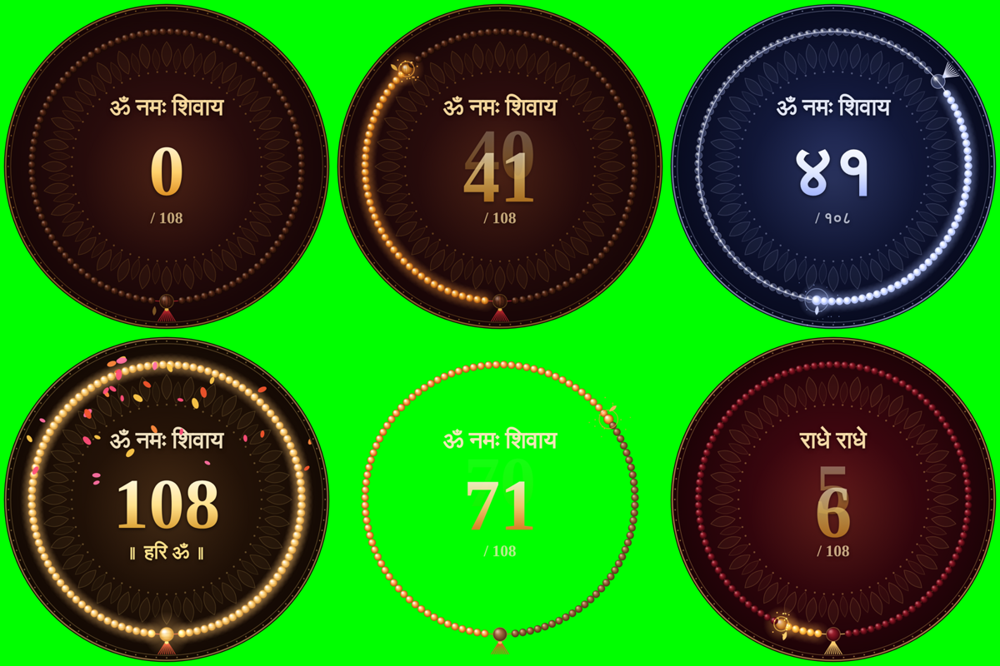

# ॐ Naam Jaap Counter Studio

A free, glowing **108-bead mala counter** for mantra jaap videos.
Drop in your chant audio. The app finds every repetition and exports a **green-screen MP4** you can overlay picture-in-picture on your video.

**▶ Open the app:** https://rohitdhamija.github.io/naam-jaap-counter/

Made for the YouTube channel **[Naam Jaap 108 (@dailyjaap108)](https://www.youtube.com/@dailyjaap108)**.



## Features

- **Automatic chant detection**: tell it how many jaaps (e.g. 108) and it places exactly that many markers, even if each chant has a different length or the singer speeds up.
- **Easy correction**: a timeline where you can drag, add or delete markers, or use *Tap along* (press Space at each chant) and *Snap*.
- **108-bead mala animation**: each bead lights up in turn, a pointer moves bead by bead, and petals fall on completion.
- **5 mala styles**: Rudraksha, Chandan, Tulsi, Sphatik and Kumkum. Numbers can be Latin or Devanagari (१०८), and the mala can be still or turning.
- **Green-screen MP4 export** in 720p, 1080p, 1440p or 4K, with the chant audio included if you want it.
- **Private**: everything runs in your browser and your audio is never uploaded.



## How to use

1. Open the app in **Google Chrome** (Safari can't export video).
2. Drop your chant audio or video onto the page.
3. Check the markers. Orange ones are worth a quick listen; press `.` to jump to the next marker.
4. Choose your style, then click **Export MP4**.
5. In iMovie, Final Cut, Premiere or DaVinci, place the MP4 above your video at 0:00, apply a green-screen key, and scale it into a corner.

Tip: in Chrome, choose ⋮ → *Cast, save and share* → **Install page as app** to get a Dock icon.

## For developers

`index.html` is the built, self-contained app that GitHub Pages serves. The sources are in `src/`:

- `src/detect.js`: chant detection (spectral onset detection, chant fingerprint, dynamic programming)
- `src/render.js`: the mala renderer
- `src/app.js`: the studio UI and MP4 export (WebCodecs + [mp4-muxer](https://github.com/Vanilagy/mp4-muxer), MIT)

After editing, rebuild from the repo root:

```
python3 src/build.py
```
